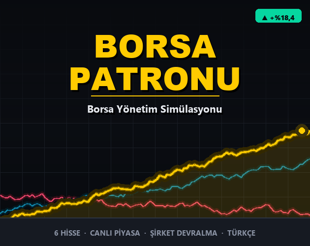

# Borsa Patronu

Küçük bir sermayeyle borsa imparatorluğu kurduğun bir borsa yönetim oyunu.
C++17 + [raylib](https://www.raylib.com/) ile yazıldı; Windows'ta ve tarayıcıda
(telefonda da) çalışır. Türkçe ve İngilizce.

*A stock market tycoon game written in C++17 + raylib. Runs on Windows and in the
browser, phones included. Turkish and English. (English summary below.)*

### ▶ Tarayıcıda oyna / Play in your browser: **https://emrebiltekin.me/borsa-patronu/**



## Oyun

- Haber çıkar, fiyata **5 saniye sonra** yansır. İyi mi kötü mü? Okuyup sen karar verirsin.
- Büyük ve aceleci emirler pahalıdır; emri zamana yayarsan ucuzlar.
- Rütbe atladıkça yeni hisseler ve araçlar açılır: emirler, açığa satış, altın ve
  dolar, kredi.
- Her hissenin bir değerleme etiketi var: pahalılaşan hisse riskli, ucuzlayan fırsattır.
- Bir şirketin 1000 hissesinden 501'ini toplarsan patronu olursun; riskli yönetim
  kararları gerçek birer kumardır.
- Görevler, senaryolar, herkesin aynı piyasayı oynadığı **Günün Piyasası**, başarımlar,
  bilanço takvimi, küresel olaylar, kaydet/yükle.
- Pencereye uyar: geniş ekranda yanlarda boşluk kalmaz, telefonda dikey yerleşime geçer.

Şirket kodları gerçek BIST kodlarından esinlenmiştir; **fiyatlar, haberler ve olaylar
tamamen kurgusaldır.** Yatırım tavsiyesi değildir.

## Derleme

Gerekenler: [raylib](https://www.raylib.com/) (Windows kurulumu `C:\raylib` altına
w64devkit ve emscripten ile birlikte gelir) ve Python 3.

```
python build.py          Windows .exe
python build.py test     denge testi + görsel test (yerleşim denetçisi)
python build.py web      tarayıcı sürümü (web_cikti/)
python build.py paket    hepsi + release/ altına zip'ler
python build.py sun      web sürümünü http://localhost:8765 adresinde sunar
python build.py yayinla  web sürümünü derleyip GitHub Pages'e gönderir
```

Araç yolları `build.py` dosyasının başındaki sabitlerdedir. Derlenen tek dosya
`borsa_patronu.cpp`'dir; oyunun parçaları `src/` altında konusuna göre ayrılmıştır.

Kodun yapısı, tasarım kararları ve denge ölçümleri için: [PROJE_NOTLARI.md](PROJE_NOTLARI.md).

## Testler

- **Denge testi** oyun mantığını pencere açmadan çalıştırır: al-sat döngülerinin
  kâr ettirmediğini doğrular ve botlara yüzlerce oyun oynatıp rütbelere ulaşma
  sürelerini ölçer.
- **Görsel test** her ekranı sekiz pencere boyutunda ve iki dilde çizer, üst üste
  binen ya da taşan yazıları otomatik raporlar ve sahte tıklamalarla temel akışları sınar.

---

## English

**Borsa Patronu** ("Market Boss") is a stock market tycoon game: start with a small
stake, read the news, and build an empire.

- News hits the price **5 seconds after** it is announced. Good or bad? You read it
  and decide.
- Large, rushed orders are expensive; spreading an order over time makes it cheaper.
- Ranking up unlocks new stocks and tools: orders, short selling, gold and dollars,
  credit.
- Every stock carries a valuation tag: pricey stocks are risky, cheap ones are chances.
- Collect 501 of a company's 1000 shares to become its boss; risky management calls
  are real gambles.
- Missions, scenarios, a **Daily Market** where everyone plays the same market,
  achievements, an earnings calendar, global events, save/load.
- Fits the window: no side bars on wide screens, a portrait layout on phones.

Tickers are inspired by real BIST tickers; **all prices, news and events are entirely
fictional.** Not investment advice.

### Building

You need [raylib](https://www.raylib.com/) (the Windows installer puts it under
`C:\raylib`, together with w64devkit and emscripten) and Python 3. Run
`python build.py` for the Windows build, `python build.py web` for the browser build
and `python build.py test` for the tests. Tool paths are constants at the top of
`build.py`. The code and comments are in Turkish.
